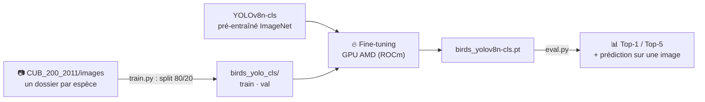

<h1 align="center">🐦 PyBirds</h1>

<p align="center">
  <strong>Reconnaître l'espèce d'un oiseau sur une photo, parmi 200 espèces,<br/>
  avec YOLOv8 entraîné sur un GPU AMD (ROCm).</strong>
</p>

<p align="center">
  
  
  
  
  
  
</p>

---

On part d'un modèle **YOLOv8n-cls** pré-entraîné sur ImageNet et on l'affine sur le jeu de données
**CUB-200-2011** (près de 12 000 photos, 200 espèces). Le tout tourne sur une **Radeon RX 7900 XTX** avec ROCm,
une configuration moins courante que CUDA.

## ✨ Fonctionnalités

- **🗂️ Préparation automatique** du jeu de données : découpage entraînement / validation 80/20.
- **🔁 Reprise de l'entraînement** : si un modèle personnalisé existe déjà, on repart de lui.
- **📊 Évaluation Top-1 et Top-5** sur le jeu de validation.
- **🖼️ Prédiction sur une image** au choix, avec les probabilités par espèce.

## 🧠 Comment ça marche



| Paramètre | Valeur |
|---|---|
| Taille d'image | 224 × 224 |
| Époques | 50 (arrêt anticipé après 10 sans progrès) |
| Batch | 32 |
| Optimiseur | AdamW, `lr0 = 1e-3` |

## 🚀 Démarrage rapide

### Prérequis

- Python 3.10+ et un GPU AMD compatible ROCm (Ubuntu 24.04 testé)
- Le jeu de données [CUB-200-2011](https://data.caltech.edu/records/65de6-vp158), décompressé à la racine du projet

### Lancement

```bash
git clone https://github.com/DHoudetot-Cyril/PyBirds.git
cd PyBirds
python -m venv venv && source venv/bin/activate
pip install -r requirements.txt

python test_rocm.py   # vérifie que PyTorch voit le GPU AMD
python train.py       # prépare les données et entraîne (ou reprend)
python eval.py        # Top-1 / Top-5
```

Pour tester sur votre propre photo, renseignez `IMG_TEST = "chemin/vers/image.jpg"` dans `eval.py`.

> Sur carte NVIDIA, remplacez les roues `+rocm6.1` du `requirements.txt` par les versions CUDA de PyTorch.

## 📁 Structure du projet

```text
PyBirds/
├── train.py          # préparation des données + fine-tuning (avec reprise)
├── eval.py           # Top-1 / Top-5 et prédiction sur une image
├── test_rocm.py      # vérifie PyTorch + ROCm
├── CUB_200_2011/     # dataset (non versionné)
└── birds_yolo_cls/   # split train/val généré automatiquement
```

## 🩹 Dépannage

| Problème | Solution |
|---|---|
| L'entraînement repart de zéro | Vérifiez que `birds_yolov8n-cls.pt` est présent avant `python train.py` |
| Mémoire GPU saturée | Baissez `BATCH_SIZE` à 16 ou 8 dans `train.py` |
| Images `.png` ou `.jpeg` ignorées | Ajoutez ces extensions dans `prepare_dataset()` |

## 🗺️ Pistes d'amélioration

- [ ] Publier les scores Top-1 / Top-5 obtenus et la matrice de confusion
- [ ] Comparer avec un modèle plus grand (YOLOv8s-cls, ConvNeXt)
- [ ] Petite démo web : on dépose une photo, on obtient l'espèce

## 👤 Auteur

**Cyril D'Houdetot** · [GitHub](https://github.com/DHoudetot-Cyril)

<sub>Vérifiez la licence du jeu de données CUB-200-2011 avant tout usage autre que la recherche ou l'apprentissage.</sub>
